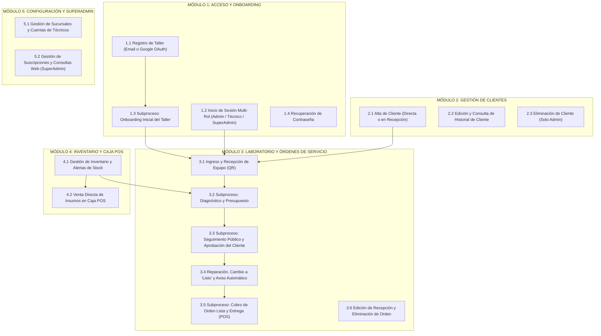

# Manual Maestro de Procesos de Negocio (BPMN 2.0) — Plataforma RepairIT
**Documento Técnico para Modelado en Bizagi Modeler**

---

## 1. Convenciones y Guía Rápida para Bizagi Modeler

Para trasladar este documento directamente a **Bizagi Modeler**, cada paso de cada proceso está etiquetado con la nomenclatura estándar **BPMN 2.0**:

### 1.1. Tipos de Tareas (Actividades)
* **`[Tarea Manual]` (Manual Task — ícono de mano)**: Acción física en el mundo real sin intervención directa del software (ej. recibir un celular roto en el mostrador, desarmar un equipo, entregar el ticket impreso al cliente).
* **`[Tarea de Usuario]` (User Task — ícono de persona)**: Acción donde un humano (Admin, Técnico, Cliente o SuperAdmin) interactúa con la pantalla de **RepairIT** (completar un formulario, hacer clic en un botón, seleccionar un estado).
* **`[Tarea de Servicio]` (Service Task — ícono de engranajes)**: Proceso automático ejecutado por el backend/base de datos (**Supabase PostgreSQL / Auth / API**) sin intervención humana (insertar fila, validar token JWT, actualizar stock).
* **`[Tarea de Script]` (Script Task — ícono de pergamino/código)**: Cálculo o generación local automática en la aplicación (generar código único `RT-XXXXXX`, calcular sumatoria de presupuesto, generar documento `.xlsx` o plantilla HTML de impresión).
* **`[Tarea de Envío]` (Send Task — ícono de sobre oscuro)**: Disparo de una notificación hacia un sistema externo (correo transaccional vía **EmailJS**, correo de seguridad vía **Supabase Auth**, o apertura de API de **WhatsApp**).
* **`[Subproceso]` (Sub-Process — caja con signo `[+]`)**: Conjunto de actividades agrupadas que tienen su propio flujo interno y pueden reutilizarse desde varios procesos principales.

### 1.2. Tipos de Compuertas (Gateways — Rombos)
* **`<Compuerta Exclusiva XOR>` (Rombo con una X)**: Evalúa una condición y toma **un único camino** posible (ej. *¿El cliente ya existe en la base de datos? Sí / No*).
* **`<Compuerta Paralela AND>` (Rombo con un signo +)**: Divide el flujo en dos o más caminos que ocurren simultáneamente (ej. *Actualizar estado en BD* y *Enviar email de notificación*).

### 1.3. Almacenes de Datos (`Data Stores` — Cilindros en Bizagi)
Cuando un paso dice **`[PERSISTENCIA EN BD]`**, en Bizagi podés dibujar un **Data Store** conectado con una línea punteada (`Data Association`) hacia la Tarea de Servicio correspondiente:
1. **`auth.users` (Supabase Auth)**: Credenciales encriptadas, tokens OAuth de Google y sesiones JWT.
2. **`profiles` (Tabla PostgreSQL)**: Datos del taller principal, plan de suscripción (`free`, `pro`, `enterprise`), rol (`admin`, `superadmin`) y estado de cuenta (`active`, `suspended`).
3. **`venues` (Tabla PostgreSQL)**: Sucursales o sedes asociadas a una cuenta de taller.
4. **`staff_accounts` (Tabla PostgreSQL)**: Cuentas operativas internas de técnicos o administradores secundarios creadas para cada sucursal.
5. **`clients` (Tabla PostgreSQL)**: Directorio de clientes por sucursal (`name`, `dni`, `phone`, `email`, `venue_id`).
6. **`orders` (Tabla PostgreSQL)**: Órdenes de servicio técnico (`tracking_code`, `client_id`, `device_type`, `device_model`, `issue`, `diagnosis`, `status`, `budget` JSONB, `history` JSONB, `venue_id`).
7. **`inventory` (Tabla PostgreSQL)**: Catálogo de repuestos e insumos (`code`, `name`, `category`, `stock`, `min_stock`, `cost_price`, `sale_price`, `venue_id`).
8. **`sales` (Tabla PostgreSQL)**: Registro histórico de cobros y ventas en Caja POS (`items` JSONB, `total`, `payment_method`, `venue_id`).
9. **`contact_messages` (Tabla PostgreSQL)**: Consultas enviadas por potenciales clientes desde el formulario público de la Landing Page.

---

## 2. Mapa General de Procesos (Arquitectura BPM)

---

## 3. Desarrollo Detallado de Procesos para Bizagi

---

### PROCESO 1.1: Registro de Nuevo Taller (Administrador)
* **Tipo en Bizagi**: Proceso Principal (`Pool: Registro de Cuenta en RepairIT`).
* **Lanes (Carriles)**:
  1. `Dueño de Taller / Usuario`
  2. `Sistema RepairIT (Frontend + Supabase)`
  3. `Proveedor Externo (Google OAuth / Servidor de Correo)`
* **Evento de Inicio**: El usuario ingresa a `/register` o hace clic en *"Comenzar Gratis"* desde la Landing Page.

#### Secuencia de Flujo:
1. **`[Tarea de Usuario]` Elegir método de registro**: El usuario decide si registrarse completando el formulario tradicional o mediante su cuenta de Google.
2. **`<Compuerta Exclusiva XOR>` ¿Método de registro elegido?**
   * **Camino A: Registro Manual (Email y Contraseña)**
     * **2A.1. `[Tarea de Usuario]` Completar formulario de registro**: Ingresa Nombre del Taller, Email corporativo/personal, Contraseña, Confirmación de Contraseña, elige el Plan inicial (`Free`, `Pro`, `Enterprise`) y acepta los Términos y Condiciones.
     * **2A.2. `[Tarea de Script]` Validar formato y coincidencia de contraseñas**: El frontend verifica que las contraseñas coincidan, tengan al menos 6 caracteres y se hayan aceptado los términos.
     * **2A.3. `<Compuerta Exclusiva XOR>` ¿Datos válidos?**
       * *No*: Muestra alerta de error en pantalla y vuelve al paso **2A.1**.
       * *Sí*: Continúa al paso **2A.4**.
     * **2A.4. `[Tarea de Servicio]` Crear usuario en Supabase Auth (`supabase.auth.signUp`)**:
       * **`[PERSISTENCIA EN BD]`**: Se inserta el usuario en `auth.users` con metadata (`name`, `role: "admin"`, `subscriptionPlan`).
     * **2A.5. `[Tarea de Servicio]` Crear perfil y sucursal inicial**:
       * **`[PERSISTENCIA EN BD]`**: Se crea el registro en la tabla `profiles` (`id`, `email`, `name`, `role: "admin"`, `subscription_plan`, `status: "active"`) y se crea la sede principal en la tabla `venues`.
   * **Camino B: Registro / Acceso Rápido con Google OAuth**
     * **2B.1. `[Tarea de Usuario]` Clic en botón "Continuar con Google"**.
     * **2B.2. `[Tarea de Servicio]` Redirigir a pasarela Google OAuth 2.0 (`signInWithOAuth`)**: Solicita scopes `openid`, `email`, `profile`.
     * **2B.3. `[Tarea de Usuario]` Seleccionar cuenta de Google y autorizar**: El usuario elige su correo en la ventana de Google.
     * **2B.4. `[Tarea de Servicio]` Recibir callback OAuth y token de sesión**: Supabase valida el código de autorización con Google y redirige a `/dashboard`.
     * **2B.5. `[Tarea de Servicio]` Verificar o inicializar perfil en base de datos**:
       * **`[PERSISTENCIA EN BD]`**: Si el usuario de Google entra por primera vez, el sistema inserta automáticamente su fila en `profiles` con rol `admin`, plan `free` y estado `active`.
3. **`[Tarea de Servicio]` Guardar sesión activa en navegador**:
   * **`[PERSISTENCIA LOCAL]`**: Se almacena el token JWT de Supabase y el objeto `user` en `localStorage`.
4. **`[Subproceso]` Ejecutar Onboarding Inicial del Taller `[+]`** (Ver Proceso 1.3).
5. **Evento de Fin**: Cuenta creada y usuario posicionado en el Panel Principal (`/dashboard`).

---

### PROCESO 1.2: Inicio de Sesión Multi-Rol (Admin, Técnico y SuperAdmin)
* **Tipo en Bizagi**: Proceso Principal (`Pool: Autenticación de Usuarios`).
* **Lanes (Carriles)**:
  1. `Usuario (Admin / Técnico / SuperAdmin)`
  2. `Sistema RepairIT (Auth Engine & Base de Datos)`
  3. `Google Identity (OAuth 2.0)`
* **Evento de Inicio**: El usuario accede a `/login`.

#### Secuencia de Flujo:
1. **`[Tarea de Usuario]` Seleccionar modalidad de ingreso**: Ingreso con credenciales (Email/Contraseña) o botón *"Continuar con Google"*.
2. **`<Compuerta Exclusiva XOR>` ¿Modalidad seleccionada?**
   * **Camino A: Ingreso con Google OAuth**
     * **2A.1. `[Tarea de Usuario]` Autenticarse en ventana de Google**.
     * **2A.2. `[Tarea de Servicio]` Validar token OAuth con Supabase Auth**: Recupera la sesión y consulta la tabla `profiles`.
   * **Camino B: Ingreso con Email y Contraseña**
     * **2B.1. `[Tarea de Usuario]` Ingresar Email y Contraseña** y presionar *"Ingresar al Panel"*.
     * **2B.2. `[Tarea de Servicio]` Intentar autenticación primaria en Supabase Auth (`signInWithPassword`)**.
     * **2B.3. `<Compuerta Exclusiva XOR>` ¿Existe en `auth.users` (Cuenta Principal Admin/SuperAdmin)?**
       * **Sí (Es Admin Dueño o SuperAdmin)**:
         * **2B.3.1. `[Tarea de Servicio]` Consultar perfil en tabla `profiles`**: Obtiene `role` (`admin` o `superadmin`), `subscription_plan` y `status`.
       * **No (Falla en Auth primario → Verificar si es Cuenta Interna de Sucursal / Técnico)**:
         * **2B.3.2. `[Tarea de Servicio]` Consultar tabla `staff_accounts` (RPC / Query de cuentas de personal)**: Verifica si el email y contraseña corresponden a un `tecnico` o `admin` secundario creado por un taller en la tabla `staff_accounts`.
         * **2B.3.3. `<Compuerta Exclusiva XOR>` ¿Credenciales válidas en `staff_accounts` y cuenta activa?**
           * *No*: Retorna error *"Credenciales inválidas"* -> **Evento de Fin de Error**.
           * *Sí*: Recupera el `venue_id` (sucursal asignada), el `owner_id` (dueño del taller) y el `subscription_plan` heredado del taller principal.
3. **`<Compuerta Exclusiva XOR>` ¿La cuenta del taller está suspendida (`status === "suspended"`)?**
   * *Sí*: **`[Tarea de Servicio]` Bloquear acceso**: Cierra la sesión y muestra mensaje *"Tu cuenta se encuentra suspendida"*. -> **Evento de Fin de Error**.
   * *No*: Continúa al paso 4.
4. **`[Tarea de Servicio]` Persistir contexto de sesión y sucursal activa**:
   * **`[PERSISTENCIA LOCAL]`**: Guarda en `localStorage` los datos de `user` (`id`, `name`, `email`, `role`, `subscriptionPlan`, `venueId`) y `activeVenueId`.
5. **`<Compuerta Exclusiva XOR>` ¿Cuál es el Rol del Usuario autenticado?**
   * **Rol = `superadmin`**: Redirige a Vista Global de Suscripciones (`/dashboard` modo SuperAdmin).
   * **Rol = `admin`**: Redirige a Dashboard Analítico de Taller (`/dashboard` con acceso completo a Configuración, Cuentas y Eliminación).
   * **Rol = `tecnico`**: Redirige a Dashboard Operativo de Taller (`/dashboard` con permisos restringidos: sin acceso a Configuración de Taller, sin Cuentas de Acceso y sin permiso de eliminar registros).
6. **Evento de Fin**: Sesión iniciada según perfil de permisos.

---

### SUBPROCESO 1.3: Onboarding Inicial del Taller `[+]`
* **Tipo en Bizagi**: Subproceso Embebido (`Sub-Process`), disparado automáticamente al entrar a `/dashboard` cuando el usuario tiene rol `admin` y aún no configuró los datos de su taller.
* **Lanes**: `Administrador de Taller` | `Sistema RepairIT`.
* **Evento de Inicio**: Detección automática de perfil incompleto al cargar `DashboardLayout`.

#### Secuencia de Flujo:
1. **`[Tarea de Servicio]` Mostrar Modal de Bienvenida (Onboarding)**: Despliega el asistente de configuración inicial.
2. **`[Tarea de Usuario]` Completar datos comerciales del taller**: Ingresa Nombre Comercial del Taller, Dirección física de atención, Teléfono / WhatsApp de contacto y sube opcionalmente el Logo.
3. **`[Tarea de Servicio]` Actualizar perfil y sucursal principal**:
   * **`[PERSISTENCIA EN BD]`**: Actualiza la fila en `profiles` y en `venues` (`name`, `address`, `phone`, `logo_url`).
   * **`[PERSISTENCIA LOCAL]`**: Marca flag de onboarding completado en `localStorage`.
4. **Evento de Fin**: Taller configurado y listo para emitir comprobantes con membrete propio.

---

### PROCESO 1.4: Recuperación y Restablecimiento de Contraseña
* **Tipo en Bizagi**: Proceso Principal.
* **Lanes**: `Usuario` | `Sistema RepairIT (Supabase Auth)` | `Proveedor de Correo`.
* **Evento de Inicio**: El usuario hace clic en *"¿Olvidaste tu clave?"* en `/login` (va a `/forgot-password`).

#### Secuencia de Flujo:
1. **`[Tarea de Usuario]` Ingresar correo electrónico de la cuenta** y presionar *"Enviar Instrucciones"*.
2. **`[Tarea de Servicio]` Solicitar token de recuperación (`supabase.auth.resetPasswordForEmail`)**: Genera un token temporal criptográfico con redirección a `/reset-password`.
3. **`[Tarea de Envío]` Enviar email con enlace de restablecimiento**: El servidor de correo de Supabase envía el link al usuario.
4. **`[Tarea de Usuario]` Abrir enlace del correo e ingresar nueva contraseña**: El usuario entra a `/reset-password`, escribe su nueva clave dos veces y confirma.
5. **`[Tarea de Servicio]` Actualizar credencial en BD (`supabase.auth.updateUser`)**:
   * **`[PERSISTENCIA EN BD]`**: Se actualiza el hash de contraseña en `auth.users`.
6. **Evento de Fin**: Contraseña actualizada y redirección a `/login`.

---

### PROCESO 2.1: Creación de Cliente (Alta en Directorio o durante Ingreso)
* **Tipo en Bizagi**: Subproceso Reutilizable (`Call Activity`), ya que puede ejecutarse directamente desde **Directorio de Clientes (`/dashboard/clientes`)** o invocarse automáticamente dentro de **Nuevo Ingreso (`/dashboard/nuevo-ingreso`)**.
* **Lanes**: `Admin o Técnico` | `Sistema RepairIT`.
* **Evento de Inicio**: Necesidad de registrar un cliente nuevo.

#### Secuencia de Flujo:
1. **`[Tarea de Usuario]` Ingresar datos del cliente**: Nombre y Apellido (obligatorio), DNI / CUIT (obligatorio), Teléfono / WhatsApp (obligatorio) y Correo Electrónico (opcional, usado para notificaciones automáticas).
2. **`[Tarea de Servicio]` Verificar duplicidad de DNI en la sucursal actual**: Consulta en la tabla `clients` filtrando por `venue_id` y `dni`.
3. **`<Compuerta Exclusiva XOR>` ¿Ya existe un cliente con ese DNI en la sucursal?**
   * *Sí*: Si es desde *Nuevo Ingreso*, vincula/actualiza el cliente existente; si es desde *Alta Manual*, informa o actualiza los datos de contacto.
   * *No*: Continúa al paso 4.
4. **`[Tarea de Servicio]` Insertar nuevo cliente en Base de Datos**:
   * **`[PERSISTENCIA EN BD]`**: Inserta registro en tabla `clients` (`name`, `dni`, `phone`, `email`, `user_id`, `venue_id`, `created_at`).
5. **Evento de Fin**: Cliente registrado y disponible con su `id` único.

---

### PROCESO 2.2: Eliminación de Cliente
* **Tipo en Bizagi**: Proceso Principal / Operación de Mantenimiento.
* **Lanes**: `Administrador de Taller` | `Sistema RepairIT`.
* **Evento de Inicio**: Clic en el ícono de eliminar (`Trash2`) sobre la fila o tarjeta de un cliente en `/dashboard/clientes`.

#### Secuencia de Flujo:
1. **`<Compuerta Exclusiva XOR>` ¿El usuario tiene rol `admin`?** *(Nota: a los usuarios con rol `tecnico` el sistema les oculta el botón y bloquea la función).*
   * *No (`tecnico`)*: Bloquea la acción y muestra error *"Permiso denegado"*. -> **Evento de Fin de Error**.
   * *Sí (`admin`)*: Continúa al paso 2.
2. **`[Tarea de Servicio]` Verificar órdenes asociadas al cliente**: El sistema comprueba cuántas órdenes tiene el cliente en la lista actual.
3. **`[Tarea de Usuario]` Confirmar eliminación en diálogo de seguridad (`AlertDialog`)**: El administrador confirma que desea borrar el cliente.
4. **`[Tarea de Servicio]` Eliminar registro en Base de Datos (`api.clients.delete`)**:
   * **`[PERSISTENCIA EN BD]`**: Ejecuta `DELETE FROM clients WHERE id = client_id`.
5. **Evento de Fin**: Cliente eliminado y listado actualizado.

---

### PROCESO 3.1: Creación de Orden de Servicio (Nuevo Ingreso de Equipo)
* **Tipo en Bizagi**: Proceso Principal Core (`Pool: Recepción e Ingreso de Equipo en Laboratorio`).
* **Lanes**:
  1. `Cliente`
  2. `Recepcionista (Admin o Técnico)`
  3. `Sistema RepairIT`
  4. `Servicios de Notificación (EmailJS)`
* **Evento de Inicio**: El cliente se presenta en el taller con un dispositivo para reparar y el operador abre `/dashboard/nuevo-ingreso`.

#### Secuencia de Flujo:
1. **`[Tarea Manual]` Recibir dispositivo físico en mostrador**: El operador inspecciona visualmente el equipo junto al cliente (rayones, golpes, si enciende, accesorios que deja como cargador o funda).
2. **`[Tarea de Usuario]` Buscar cliente por DNI o Nombre**: El operador escribe el DNI o nombre en el buscador inteligente de *Nuevo Ingreso*.
3. **`<Compuerta Exclusiva XOR>` ¿El cliente ya está registrado?**
   * *Sí*: **`[Tarea de Usuario]` Seleccionar cliente de la lista desplegable**: El sistema autocompleta automáticamente Nombre, DNI, Teléfono y Email.
   * *No*: **`[Tarea de Usuario]` Completar campos del nuevo cliente** en el mismo formulario (se ejecutará el **Subproceso 2.1** al guardar).
4. **`[Tarea de Usuario]` Cargar datos técnicos del dispositivo y recepción**:
   * Selecciona **Categoría** (`Smartphone`, `Notebook`, `Tablet`, `Consola`, `PC / Placa`, `Otro`).
   * Ingresa **Marca y Modelo**, **Número de Serie / IMEI** (opcional), **Clave / Patrón de Desbloqueo** (opcional).
   * Describe la **Falla Reportada por el Cliente** (obligatorio).
   * Detalla **Estado Estético** y **Accesorios Entregados** (cargador, bolso, chip, etc.).
   * Presiona *"Registrar Ingreso de Equipo"*.
5. **`[Tarea de Servicio]` Resolver registro del cliente**:
   * **`[PERSISTENCIA EN BD]`**: Si el cliente no existía, lo inserta en la tabla `clients`; si existía y se modificó su teléfono/email, actualiza su ficha en `clients`.
6. **`[Tarea de Script]` Generar Código Único de Seguimiento (`trackingCode`)**: Genera un código alfanumérico corto de alta legibilidad con formato `RT-XXXXXX` (ej. `RT-7G3H5J8K`) e inicializa la bitácora (`history`) con el hito *"Equipo ingresado a laboratorio para revisión técnica."* con fecha y hora de Argentina (`America/Argentina/Buenos_Aires`, formato 24 hs).
7. **`[Tarea de Servicio]` Guardar Orden de Servicio en Base de Datos (`api.orders.create`)**:
   * **`[PERSISTENCIA EN BD]`**: Inserta la orden en la tabla `orders` con estado inicial `status = "ingresado"`, vinculada a `client_id`, `user_id` y `venue_id`.
8. **`<Compuerta Paralela AND>` Acciones post-registro simultáneas**:
   * **Rama 1 (Notificación por Email)**:
     * **`<Compuerta Exclusiva XOR>` ¿El cliente tiene email válido cargado?**
       * *Sí*: **`[Tarea de Envío]` Enviar correo automático de recepción (`sendWelcomeOrderEmail`)** vía EmailJS con el código `RT-XXXXXX` y el link directo al portal de seguimiento.
       * *No*: Omite el envío de correo.
   * **Rama 2 (Pantalla de Éxito y Comprobante)**:
     * **`[Tarea de Servicio]` Mostrar pantalla de confirmación con Código QR**: Muestra el código `RT-XXXXXX` en pantalla con accesos directos a Imprimir y WhatsApp.
9. **`[Tarea de Usuario]` Emitir Comprobante de Recepción**: El operador hace clic en *"Imprimir Comprobante (A4 + QR)"* o *"Enviar por WhatsApp"*.
10. **`[Tarea de Script]` Generar documento A4 con Código QR (`printOrderReceipt`)**: Construye el comprobante oficial por duplicado (copia Cliente + talón para pegar al equipo) con el QR que apunta a `https://tracking.repairit.cloud/seguimiento/RT-XXXXXX`.
11. **`[Tarea Manual]` Entregar comprobante al cliente y etiquetar el equipo físico**.
12. **Evento de Fin**: Equipo ingresado en laboratorio en estado `Ingresado`.

---

### SUBPROCESO 3.2: Diagnóstico Técnico y Confección de Presupuesto `[+]`
* **Tipo en Bizagi**: Subproceso (`Sub-Process`) ejecutado desde **Órdenes de Servicio (`/dashboard/ordenes`)**.
* **Lanes**: `Técnico o Admin` | `Sistema RepairIT` | `EmailJS`.
* **Evento de Inicio**: El técnico toma un equipo de la mesa de trabajo y hace clic en el botón **"Diagnóstico"** de la orden.

#### Secuencia de Flujo:
1. **`[Tarea Manual]` Revisar y diagnosticar físicamente el dispositivo en banco de trabajo**: Medición electrónica, pruebas de componentes y determinación de repuestos necesarios.
2. **`[Tarea de Usuario]` Redactar informe de diagnóstico técnico**: En el modal de *Diagnóstico y Presupuesto*, escribe el detalle técnico de la falla encontrada.
3. **`[Tarea de Usuario]` Armar ítems del presupuesto**:
   * Puede agregar ítems manuales (ej. *"Mano de obra micro-soldadura"*, monto `\$45.000`).
   * O puede seleccionar un repuesto directamente del selector **"Vincular Insumo de Inventario"** (ej. *"Módulo Pantalla Samsung S23"*), lo cual autocompleta la descripción y el precio de venta desde el catálogo.
4. **`[Tarea de Script]` Calcular total presupuestado en tiempo real**: Suma automáticamente todos los ítems cargados.
5. **`[Tarea de Usuario]` Definir si descuenta stock de repuestos y elegir nuevo estado**:
   * Marca o desmarca el tilde *"Descontar automáticamente del stock los repuestos de inventario incluidos"*.
   * Selecciona el nuevo estado de la orden (`En Diagnóstico`, `Presupuestado`, `En Reparación` o `Listo para Entregar`) y presiona **"Guardar Diagnóstico y Presupuesto"**.
6. **`<Compuerta Exclusiva XOR>` ¿Hay repuestos vinculados del inventario y está activo el descuento de stock?**
   * *Sí*: **`[Tarea de Servicio]` Descontar unidades en tabla `inventory`**:
     * **`[PERSISTENCIA EN BD]`**: Resta la cantidad utilizada del campo `stock` en la tabla `inventory` para cada repuesto nuevo agregado al presupuesto.
   * *No*: No modifica la tabla `inventory`.
7. **`[Tarea de Servicio]` Actualizar Orden en Base de Datos (`api.orders.updateDiagnosis`)**:
   * **`[PERSISTENCIA EN BD]`**: Actualiza en la tabla `orders` los campos `diagnosis`, `status`, `budget` (`{ items, total, approved, rejected }`) y agrega un nuevo evento con fecha/hora 24 hs en el array `history`.
8. **`<Compuerta Exclusiva XOR>` ¿El nuevo estado es `presupuestado` y el cliente tiene email?**
   * *Sí*: **`[Tarea de Envío]` Enviar correo automático de Presupuesto Listo (`sendBudgetReadyEmail`)** informando el detalle, el monto total y el link para aprobarlo o rechazarlo desde el celular.
   * *No*: Continúa.
9. **Evento de Fin**: Orden diagnosticada y presupuestada.

---

### SUBPROCESO 3.3: Seguimiento Público y Aprobación/Rechazo de Presupuesto por el Cliente `[+]`
* **Tipo en Bizagi**: Proceso / Subproceso Público (`Pool: Portal de Autogestión del Cliente`).
* **Lanes**: `Cliente` | `Sistema RepairIT (Portal Público sin Login)`.
* **Evento de Inicio**: El cliente escanea el código QR de su comprobante, abre el link enviado por WhatsApp/Email o ingresa a `tracking.repairit.cloud` y escribe su código `RT-XXXXXX`.

#### Secuencia de Flujo:
1. **`[Tarea de Usuario]` Ingresar o escanear código de orden**: El cliente escribe el código, usa la cámara desde el navegador o sube una foto del QR.
2. **`[Tarea de Servicio]` Consultar orden pública en Base de Datos (`api.orders.getByCode`)**:
   * **`[LECTURA DE BD]`**: Busca la orden por `tracking_code` en la tabla `orders` junto con los datos del taller (`profiles`/`venues`).
3. **`<Compuerta Exclusiva XOR>` ¿Existe la orden?**
   * *No*: Muestra mensaje *"No encontramos una orden con ese código"*. -> **Evento de Fin**.
   * *Sí*: Muestra la barra de progreso en vivo (`Ingresado` → `En Diagnóstico` → `Presupuestado` → `En Reparación` → `Listo` → `Entregado`), el informe técnico, el desglose del presupuesto y el historial de movimientos con fecha y hora.
4. **`<Compuerta Exclusiva XOR>` ¿La orden tiene un presupuesto pendiente de decisión (`items.length > 0` y no está aprobado ni rechazado)?**
   * *No*: El cliente solo visualiza el estado actual y puede contactar al taller por WhatsApp. -> **Evento de Fin**.
   * *Sí*: El sistema habilita en pantalla los botones **"Aprobar Presupuesto"** y **"Rechazar Presupuesto"**.
5. **`[Tarea de Usuario]` Tomar decisión sobre el presupuesto**: El cliente presiona *Aprobar* o *Rechazar*.
6. **`[Tarea de Servicio]` Registrar decisión del cliente en Base de Datos**:
   * **Si Aprueba**:
     * **`[PERSISTENCIA EN BD]`**: Actualiza `orders.budget.approved = true`, cambia automáticamente `orders.status = "en_reparacion"` y agrega en `orders.history` el hito *"Presupuesto aprobado por el cliente desde el portal web"*.
   * **Si Rechaza**:
     * **`[PERSISTENCIA EN BD]`**: Actualiza `orders.budget.rejected = true` y agrega en `orders.history` el hito *"Presupuesto rechazado por el cliente desde el portal web"*.
7. **Evento de Fin**: Decisión registrada instantáneamente en el panel del taller.

---

### PROCESO 3.4: Reparación, Cambio a Estado "Listo" y Notificación al Cliente
* **Tipo en Bizagi**: Proceso Operativo de Laboratorio.
* **Lanes**: `Técnico / Admin` | `Sistema RepairIT` | `EmailJS / WhatsApp`.
* **Evento de Inicio**: Orden con presupuesto aprobado o en etapa de reparación.

#### Secuencia de Flujo:
1. **`[Tarea Manual]` Ejecutar reparación física y control de calidad final**: El técnico repara el dispositivo y verifica su correcto funcionamiento.
2. **`[Tarea de Usuario]` Cambiar estado de la orden a "Listo"**: Desde el desplegable de estado en `/dashboard/ordenes`, selecciona **`Listo`**.
3. **`[Tarea de Servicio]` Actualizar estado e historial en Base de Datos (`api.orders.updateStatus`)**:
   * **`[PERSISTENCIA EN BD]`**: Actualiza `orders.status = "listo"` e inserta en `orders.history` el registro `"Estado cambiado a LISTO"` con fecha y hora (24 hs Buenos Aires).
4. **`[Tarea de Servicio]` Habilitar botón de "Cobrar en Caja POS"**: Al estar en estado `listo` y poseer un presupuesto mayor a `\$0`, el sistema activa automáticamente el botón del carrito (`ShoppingCart`) en la fila/tarjeta de la orden.
5. **`<Compuerta Exclusiva XOR>` ¿El cliente tiene email registrado?**
   * *Sí*: **`[Tarea de Envío]` Enviar email automático de Equipo Listo para Retirar (`sendOrderReadyEmail`)** indicando horarios y dirección de la sucursal.
   * *No*: Continúa.
6. **`[Tarea de Usuario]` (Opcional) Enviar aviso rápido por WhatsApp**: El operador hace clic en el botón verde de WhatsApp (`MessageCircle`), lo que abre un mensaje pre-redactado con el estado actual y el link de seguimiento para enviarle al cliente.
7. **Evento de Fin**: Equipo listo en estantería de entregas esperando el retiro y cobro.

---

### SUBPROCESO 3.5: Cobro de Orden Lista en Caja POS y Entrega `[+]`
* **Tipo en Bizagi**: Subproceso Transaccional Integrado (`Órdenes` ↔ `Caja POS`).
* **Lanes**: `Cliente` | `Cajero (Admin o Técnico con acceso POS)` | `Sistema RepairIT`.
* **Precondición de Negocio**: El botón de cobro **solo se activa cuando la orden está en estado `Listo` (`status === "listo"`)** y tiene un presupuesto mayor a `\$0`.
* **Evento de Inicio**: El cliente llega a retirar su equipo y el operador hace clic en el ícono **Cobrar en Caja (`ShoppingCart`)** de la orden.

#### Secuencia de Flujo:
1. **`[Tarea de Usuario]` Seleccionar método de pago y opción de ticket**: En el modal de *Cobro de Orden en Caja POS*, el operador verifica el importe total, elige el medio de pago (**Efectivo**, **Transferencia** o **Tarjeta**) y deja marcada la opción *"Imprimir comprobante de pago al confirmar"*.
2. **`[Tarea Manual]` Recibir el pago del cliente** (efectivo, comprobante de transferencia o posnet).
3. **`[Tarea de Usuario]` Confirmar cobro**: Presiona *"Confirmar Cobro y Entregar"*.
4. **`[Tarea de Servicio]` Registrar venta en Caja POS (`api.sales.create`)**:
   * **`[PERSISTENCIA EN BD]`**: Inserta un nuevo registro en la tabla `sales` con el ítem `"Orden #RT-XXXXXX - [Equipo]"`, el monto total, el método de pago (`efectivo` / `transferencia` / `tarjeta`), `venue_id` y timestamp `created_at`.
5. **`[Tarea de Servicio]` Pasar orden automáticamente a estado "Entregado" (`api.orders.updateStatus`)**:
   * **`[PERSISTENCIA EN BD]`**: Actualiza `orders.status = "entregado"` y guarda en `orders.history`: *"Equipo entregado y cobrado en Caja POS (\$Monto - MÉTODO)"*.
6. **`<Compuerta Exclusiva XOR>` ¿Seleccionó imprimir ticket de pago?**
   * *Sí*: **`[Tarea de Script]` Generar e imprimir recibo de pago POS (`printPosReceipt`)**.
   * *No*: Continúa.
7. **`[Tarea Manual]` Entregar el equipo reparado y el recibo impreso al cliente**.
8. **Evento de Fin**: Ciclo de vida de la orden completado (`Entregado`) e ingreso financiero impactado en Caja.

---

### PROCESO 3.6: Edición de Recepción y Eliminación de Orden
* **Tipo en Bizagi**: Procesos de Corrección Administrativa en `/dashboard/ordenes`.
* **Lanes**: `Admin / Técnico` | `Sistema RepairIT`.

#### A. Subflujo: Editar Datos de Recepción (Permitido a Admin y Técnico)
1. **`[Tarea de Usuario]` Clic en ícono de lápiz (`Editar recepción`)**: Abre el modal con los datos originales del equipo y falla.
2. **`[Tarea de Usuario]` Modificar categoría, modelo, falla reportada, estética o accesorios** y presionar *"Guardar Cambios"*.
3. **`[Tarea de Servicio]` Actualizar ficha en Base de Datos (`api.orders.updateReception`)**:
   * **`[PERSISTENCIA EN BD]`**: Actualiza `device_type`, `device_model`, `issue`, `cosmetic`, `accessories` en la tabla `orders` y añade entrada en `orders.history` (*"Datos de recepción editados"*).

#### B. Subflujo: Eliminar Orden de Servicio (Exclusivo Rol `Admin`)
1. **`<Compuerta Exclusiva XOR>` ¿El usuario es `admin`?** *(Los técnicos no ven el botón de eliminar ni tienen permiso de ejecución).*
   * *No*: Rechaza la operación. -> **Evento de Fin de Error**.
   * *Sí*: Continúa.
2. **`[Tarea de Usuario]` Clic en botón Eliminar (`Trash2`) y confirmar en cuadro de diálogo**.
3. **`[Tarea de Servicio]` Eliminar orden de Base de Datos (`api.orders.delete`)**:
   * **`[PERSISTENCIA EN BD]`**: Ejecuta `DELETE FROM orders WHERE id = order_id`.
4. **Evento de Fin**: Orden eliminada permanentemente.

---

### PROCESO 4.1: Gestión de Inventario de Insumos y Alertas de Bajo Stock
* **Tipo en Bizagi**: Proceso de Soporte Logístico (`/dashboard/inventario`).
* **Lanes**: `Admin / Técnico` | `Sistema RepairIT`.

#### Secuencia de Flujo:
1. **Alta o Edición de Insumo**:
   * **1.1. `[Tarea de Usuario]` Completar formulario de Insumo**: Ingresa Código SKU (o usa el autogenerador `REP-XXXX`), Nombre del repuesto/producto, Categoría (`Pantallas`, `Baterías`, `Pines de Carga`, `IC / Componentes`, `Accesorios`, etc.), Stock Actual, Stock Mínimo de Alerta, Costo de Compra y Precio de Venta al Público.
   * **1.2. `[Tarea de Servicio]` Guardar en tabla `inventory`**:
     * **`[PERSISTENCIA EN BD]`**: Inserta (`api.inventory.create`) o actualiza (`api.inventory.update`) la fila en la tabla `inventory` asociada al `venue_id` actual.
2. **Ajuste Rápido de Stock (`+1` / `-1`)**:
   * **2.1. `[Tarea de Usuario]` Presionar botón `+` o `-` en la fila del producto**.
   * **2.2. `[Tarea de Servicio]` Actualizar stock en BD**:
     * **`[PERSISTENCIA EN BD]`**: Actualiza inmediatamente el campo `stock` en la tabla `inventory`.
3. **Monitoreo Automático de Stock Crítico**:
   * **3.1. `[Tarea de Script]` Evaluar umbral de reposición (`stock <= minStock`)**: Cada vez que cambia el inventario o se carga el panel, el sistema compara el stock actual contra el mínimo configurado.
   * **3.2. `<Compuerta Exclusiva XOR>` ¿`stock <= minStock`?**
     * *Sí*: Activa insignia roja de alerta en la Sidebar (`Inventario de Insumos [!N]`) y lista el ítem en la tarjeta **"Críticos de Inventario"** del Dashboard principal.
4. **Eliminación de Insumo (Exclusivo Rol `Admin`)**:
   * **4.1. `[Tarea de Usuario]` El Admin presiona Eliminar sobre un insumo y confirma**.
   * **4.2. `[Tarea de Servicio]` Borrar registro en tabla `inventory` (`DELETE FROM inventory`)**.

---

### PROCESO 4.2: Venta Directa en Caja POS (Mostrador)
* **Tipo en Bizagi**: Proceso Comercial Principal (`/dashboard/caja`).
* **Lanes**: `Cliente` | `Operador de Caja (Admin o Técnico en Plan Pro/Enterprise)` | `Sistema RepairIT`.
* **Evento de Inicio**: Un cliente compra un accesorio o insumo por mostrador (ej. cargador, vidrio templado, cable USB).

#### Secuencia de Flujo:
1. **`[Tarea de Usuario]` Buscar producto en el catálogo de Caja POS**: Filtra por nombre o código SKU y hace clic sobre los productos para agregarlos al carrito.
2. **`[Tarea de Script]` Validar disponibilidad de stock en carrito**: Verifica que la cantidad agregada al carrito no supere el `stock` disponible en la sucursal y calcula el subtotal y total a pagar.
3. **`[Tarea de Usuario]` Seleccionar método de pago**: Elige **Efectivo**, **Transferencia** o **Tarjeta** y presiona *"Confirmar Venta"*.
4. **`[Tarea Manual]` Cobrar al cliente**.
5. **`[Tarea de Servicio]` Registrar transacción y descontar inventario**:
   * **`[PERSISTENCIA EN BD - Paso 1]`**: Inserta la venta en la tabla `sales` (`items`, `total`, `payment_method`, `user_id`, `venue_id`, `created_at`).
   * **`[PERSISTENCIA EN BD - Paso 2]`**: Por cada producto vendido, descuenta la cantidad vendida (`stock = stock - cantidad`) en la tabla `inventory`.
6. **`[Tarea de Script]` Actualizar métricas de Arqueo de Caja**: Recalcula en vivo la Recaudación Total, cantidad de operaciones y el desglose por medio de pago (Efectivo vs. Transferencia vs. Tarjeta).
7. **`[Tarea de Usuario]` (Opcional) Imprimir Ticket de Venta (`printPosReceipt`)**: Genera comprobante impreso con fecha/hora 24 hs (Buenos Aires) y detalle de artículos.
8. **Evento de Fin**: Venta registrada y stock actualizado.

---

### PROCESO 5.1: Gestión de Sucursales (Multi-Taller) y Cuentas de Acceso del Personal
* **Tipo en Bizagi**: Proceso de Administración Interna (`/dashboard/cuentas` y Selector de Sucursal).
* **Lanes**: `Administrador Dueño del Taller` | `Sistema RepairIT`.

#### A. Subflujo: Creación y Cambio de Sucursal (Plan Enterprise)
1. **`[Tarea de Usuario]` Crear nueva Sucursal**: Ingresa Nombre de la sede (ej. *"Sucursal Centro"*, *"Sucursal Yerba Buena"*), Dirección y Teléfono.
2. **`[Tarea de Servicio]` Guardar sucursal en Base de Datos (`api.venues.create`)**:
   * **`[PERSISTENCIA EN BD]`**: Inserta fila en la tabla `venues` vinculada al `owner_id`.
3. **`[Tarea de Usuario]` Cambiar sucursal activa desde la cabecera superior**: Al elegir otra sucursal en el selector del Header, el sistema actualiza `activeVenueId` en `localStorage` y recarga órdenes, clientes, inventario y caja filtrados exclusivamente para esa sede.

#### B. Subflujo: Alta, Edición y Baja de Cuentas de Acceso (Técnicos y Admins de Sucursal)
1. **`[Tarea de Usuario]` Completar formulario de nueva Cuenta de Personal en `/dashboard/cuentas`**:
   * Ingresa Nombre del empleado, Email de acceso, Contraseña, selecciona el **Rol** (`Técnico` o `Admin`) y la **Sucursal asignada**.
2. **`[Tarea de Servicio]` Crear cuenta en tabla `staff_accounts` (`api.staffAccounts.create`)**:
   * **`[PERSISTENCIA EN BD]`**: Inserta el registro en `staff_accounts` con `name`, `email`, `password_hash`, `role`, `venue_id`, `owner_id` y `active: true`.
3. **`[Tarea de Usuario]` Pausar, cambiar clave o eliminar cuenta**: El Administrador puede desactivar temporalmente el acceso de un técnico, blanquear su contraseña o eliminar su cuenta (`DELETE FROM staff_accounts`).

---

### PROCESO 5.2: Administración Global de la Plataforma y Consultas Web (SuperAdmin)
* **Tipo en Bizagi**: Proceso de Gobierno SaaS (`/dashboard`, `/dashboard/usuarios`, `/dashboard/consultas`).
* **Lanes**: `Visitante Web / Dueño de Taller` | `SuperAdmin de RepairIT` | `Sistema RepairIT`.

#### A. Subflujo: Recepción y Gestión de Consultas Web (Landing Page → SuperAdmin)
1. **`[Tarea de Usuario]` Visitante envía consulta desde la Landing Page**: Completa Nombre, Email y Mensaje en la sección de Contacto y presiona *"Enviar Mensaje"*.
2. **`[Tarea de Servicio]` Guardar consulta en Base de Datos (`api.auth.submitContactMessage`)**:
   * **`[PERSISTENCIA EN BD]`**: Inserta el mensaje en la tabla `contact_messages` con timestamp `created_at`.
3. **`[Tarea de Servicio]` Notificar en Sidebar del SuperAdmin**: El menú lateral de SuperAdmin muestra el contador de consultas en **"Consultas Web"**.
4. **`[Tarea de Usuario]` Revisar, responder o eliminar consulta en `/dashboard/consultas`**:
   * El SuperAdmin visualiza la consulta con fecha y hora en formato 24 hs (`America/Argentina/Buenos_Aires`).
   * Si presiona **"Responder por Correo"**, abre el cliente de correo con asunto y destinatario precargados.
   * Si presiona el ícono de **Eliminar (`Trash2`)** y confirma en el diálogo modal, el sistema ejecuta `DELETE FROM contact_messages WHERE id = msg_id`.

#### B. Subflujo: Gestión de Suscripciones y Estado de Talleres Clientes
1. **`[Tarea de Usuario]` Auditar talleres registrados en `/dashboard` o `/dashboard/usuarios`**: El SuperAdmin filtra talleres por plan (`Free`, `Pro`, `Enterprise`) o estado (`Activo`, `Suspendido`).
2. **`[Tarea de Usuario]` Modificar Plan de Suscripción o Suspender/Activar Taller**: Selecciona el nuevo plan o cambia el estado de la cuenta.
3. **`[Tarea de Servicio]` Actualizar perfil del taller en Base de Datos**:
   * **`[PERSISTENCIA EN BD]`**: Actualiza `subscription_plan` o `status` en la tabla `profiles`, impactando en tiempo real en las funciones habilitadas del taller (acceso a Caja POS, Multi-Taller, etc.).
4. **Evento de Fin**: Estado o plan del cliente actualizado globalmente.

---

## 4. Matriz Resumen de Permisos por Rol (Para definir Lanes en Bizagi)

| Proceso / Acción en el Sistema | Cliente Público (Sin Login) | Rol: `Técnico` | Rol: `Admin` (Dueño/Encargado) | Rol: `SuperAdmin` |
| :--- | :---: | :---: | :---: | :---: |
| Consultar seguimiento y aprobar/rechazar presupuesto por QR/Código | ✅ Sí | ✅ Sí | ✅ Sí | ❌ No |
| Iniciar sesión con Email/Contraseña | ❌ No | ✅ Sí (`staff_accounts`) | ✅ Sí (`auth.users` / `staff_accounts`) | ✅ Sí (`auth.users`) |
| Iniciar sesión / Registrarse con Google OAuth | ❌ No | ❌ No | ✅ Sí | ✅ Sí |
| Crear y editar Clientes | ❌ No | ✅ Sí | ✅ Sí | ❌ No |
| **Eliminar Clientes** | ❌ No | ❌ **Bloqueado** | ✅ **Sí** | ❌ No |
| Crear Orden de Servicio, Diagnosticar, Presupuestar y Editar Recepción | ❌ No | ✅ Sí | ✅ Sí | ❌ No |
| Cobrar Orden en Caja POS (Solo cuando `status === "listo"`) | ❌ No | ✅ Sí *(Plan Pro/Ent)* | ✅ Sí *(Plan Pro/Ent)* | ❌ No |
| **Eliminar Orden de Servicio** | ❌ No | ❌ **Bloqueado** | ✅ **Sí** | ❌ No |
| Crear, editar y ajustar stock de Inventario | ❌ No | ✅ Sí | ✅ Sí | ❌ No |
| **Eliminar ítems de Inventario** | ❌ No | ❌ **Bloqueado** | ✅ **Sí** | ❌ No |
| Configurar Perfil del Taller, Sucursales y Cuentas de Acceso | ❌ No | ❌ **Bloqueado** | ✅ **Sí** | ❌ No |
| Administrar Suscripciones Globales, Usuarios y Consultas Web | ❌ No | ❌ No | ❌ No | ✅ **Exclusivo** |
